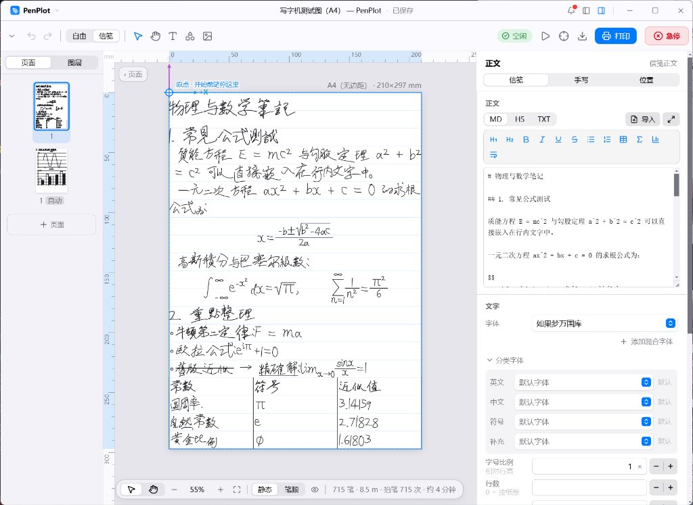
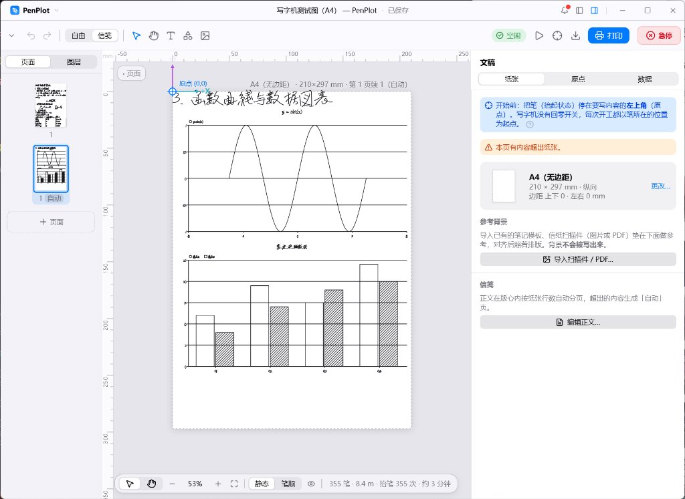

# PenPlot

**写字机 / 笔式绘图仪桌面工作台与工具包**（Electron · Python）

[English](README.en.md) · [使用手册](docs/manual/README.md) · [API](docs/api.md) · [更新日志](docs/CHANGELOG.md)

> 本项目基于上游 [jiangmuran/penplot](https://github.com/jiangmuran/penplot) 进行桌面端定制与扩展，专注于本地桌面工作台体验（Electron 桌面端、Markdown/LaTeX 排版、函数与数据图表、分类混排字体及 MCP 集成）。

PenPlot 是一款面向 GRBL / Marlin / EBB 等写字机的桌面书写与绘图软件：支持 Markdown 富文本与 LaTeX 数学公式排版、函数与数据图表、单线字体与混排、图片描线、G 代码生成与串口流控打印，并提供桌面端（Electron）、CLI 与 MCP 接口。

<p align="center">
  
  
</p>

## 核心功能

- **创作台（自由 / 信笺模式）**：支持 Markdown / HTML / 纯文本排版，内置 LaTeX 数学公式（含裸公式自动识别）、表格、多页自动分页、竖排、函数曲线与柱状/折线图表、几何图形、参考底图与笔顺/位置预览。
- **单线字体与混排**：自带开源单线字体（文楷、黑体、Cursive、Built-in Sans），支持 `.psf` / `.gfont` 读写与互转、TTF/OTF/TTC 一键提取中心线，支持按英文/中文/符号/补充分类指定字体、多字体加权混排与手写抖动。
- **图片描线与导入导出**：支持轮廓（Canny）、中心线骨架（单笔线稿）、激光点阵半调，以及 SVG / DXF / Excel 导入与 G 代码预览导出。
- **机器控制与任务队列**：点动、抬笔/落笔、设原点、走边框位置预览、宏命令、急停与断点续打，开箱即连本地串口。
- **电传打字机 & MCP**：支持按键实时书写（电传打字机），内置 `/mcp` 服务供 AI 工具调用排版与打印能力。

<details>
<summary>更多界面截图（字库、机器控制、电传打字机）</summary>

| | |
|---|---|
|  |  |
| **字库管理**：覆盖率统计、缺字检查、TTF 转单线 | **机器控制**：行程图、点动、校准、固件参数 |
|  |  |
| **电传打字机**：按键实时落笔书写 | **位置预览**：打印前确认纸张、原点与书写范围 |

</details>

## 支持的硬件

| 控制器 | 说明 |
|---|---|
| **GRBL**（推荐） | 0.9 / 1.1；支持 Z 轴步进、舵机（`M3 S…`）或激光 |
| **Marlin** | 舵机 `M280`、Z/E 轴、风扇口；行号 + 校验和 + 重发 |
| **EBB**（EiBotBoard / AxiDraw） | `SP` / `XM` 命令流 |
| **K_AT** | 自动送纸写字机（Marlin 方言） |

参考配置见 [`configs/grbl-zpen.json`](configs/grbl-zpen.json)（GRBL 1.1f，300 × 300 mm，`Z0` 抬笔 / `Z+8` 落笔，无归零限位，每次以笔所在位置为原点）。

## 快速开始

### 1. 安装与命令行

```bash
git clone https://github.com/<你的账号>/penplot.git && cd penplot
python -m venv .venv && .venv/Scripts/activate   # Linux/macOS: source .venv/bin/activate
pip install -e '.[all,dev]'

penplot font list
penplot write "床前明月光，疑是地上霜。" -f open-wenkai-stroke \
    --svg out.svg -o out.gcode --config configs/grbl-zpen.json
penplot print out.gcode -p /dev/ttyUSB0 --config configs/grbl-zpen.json
```

<details>
<summary>常用 CLI 命令</summary>

```bash
penplot font convert old.gfont new.psf                  # .gfont <-> .psf 互转
penplot font ttf 字体.ttf my-hand.psf --all             # TTF -> 单线字体
penplot img skeleton photo.png --width-mm 120 -o s.gcode # 图片转单笔线稿
penplot tool -p /dev/ttyUSB0 --config configs/grbl-zpen.json # 交互控制台
penplot gcode2svg any.gcode out.svg                     # G 代码转 SVG 预览
```

</details>

### 2. 桌面端运行与打包

```bash
# 桌面端开发模式（Electron + 本地后端）
cd desktop && npm ci && npm run dev

# 打包桌面端（先构建前端与后端，再生成安装包）
cd webui && npm ci && npm run build && cd ..
pyinstaller penplot-backend.spec
cd desktop && npm run dist
```

详细说明请查阅 [使用手册](docs/manual/README.md)。

## 字体

仓库内置可自由再分发的开源单线字体（详见 [`fonts/README.md`](fonts/README.md)）：

| 字体 | 字数 | 来源 / 许可 |
|---|---|---|
| 文楷单线（`open-wenkai-stroke`） | 7 122 | LXGW WenKai，SIL OFL 1.1 |
| 黑体单线（`open-hei-stroke`） | 7 122 | Noto Sans CJK SC，SIL OFL 1.1 |
| Cursive（`open-caveat-stroke`） | 107 | Caveat，SIL OFL 1.1 |
| `penplot-sans` | 80 | 原创内置英数单线体 |

字体查找顺序：`$PENPLOT_FONT_DIR` → `./fonts` → `./gcodeFonts` → 仓库 `fonts/` → `~/.penplot/fonts`。

## 安全须知

- **急停**：界面右上角红色急停按钮或 `Ctrl/⌘ + .`，急停后需重新设原点。
- **开工前确认**：无归零限位的机型，开始前请将笔**抬起**并停在书写区域**左上角**，使用「走边框」确认不超纸张与行程。
- 更多安全说明见 [安全须知](docs/manual/10-safety.md) 与 [SECURITY.md](SECURITY.md)。

## 项目结构

```
penplot/    Python 核心库（字体、排版、几何、图像、G 代码、串口驱动、FastAPI 后端、MCP）
webui/      React 19 + TypeScript + Vite 前端工作台
desktop/    Electron 桌面端封装与打包配置
fonts/      开源单线字体与许可证
configs/    机器配置文件
tests/      pytest 单元测试与后端 API 测试
e2e/        Playwright 端到端测试
docs/       使用手册、API 文档与设计文档
```

## 开发与测试

```bash
OPENBLAS_NUM_THREADS=1 python -m pytest -q
cd webui && npm run lint && npm run build
```

贡献指南见 [CONTRIBUTING.md](CONTRIBUTING.md)，第三方许可见 [THIRD_PARTY_NOTICES.md](THIRD_PARTY_NOTICES.md)。

## 许可

- **代码**：[GNU Affero General Public License v3.0 or later](LICENSE)（`AGPL-3.0-or-later`）
- **随附字体**：`fonts/open-*.psf` 采用 SIL Open Font License 1.1（见 [`fonts/LICENSES/`](fonts/LICENSES/)）；`penplot-sans` 随项目许可。
